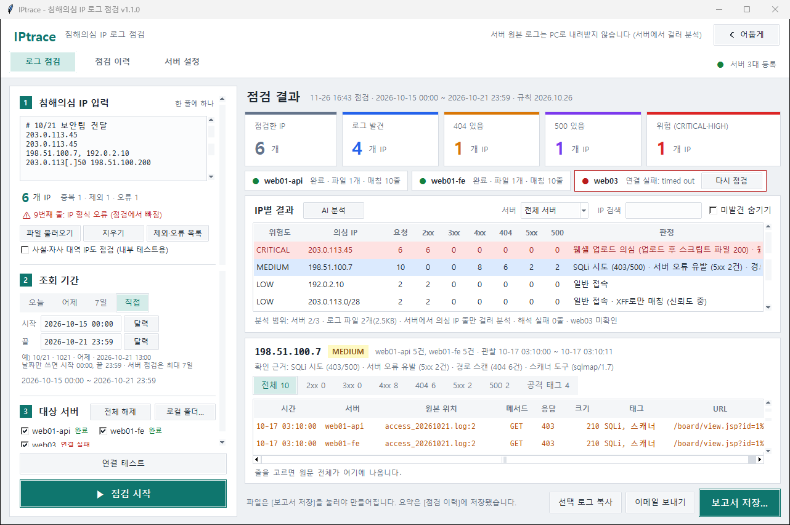
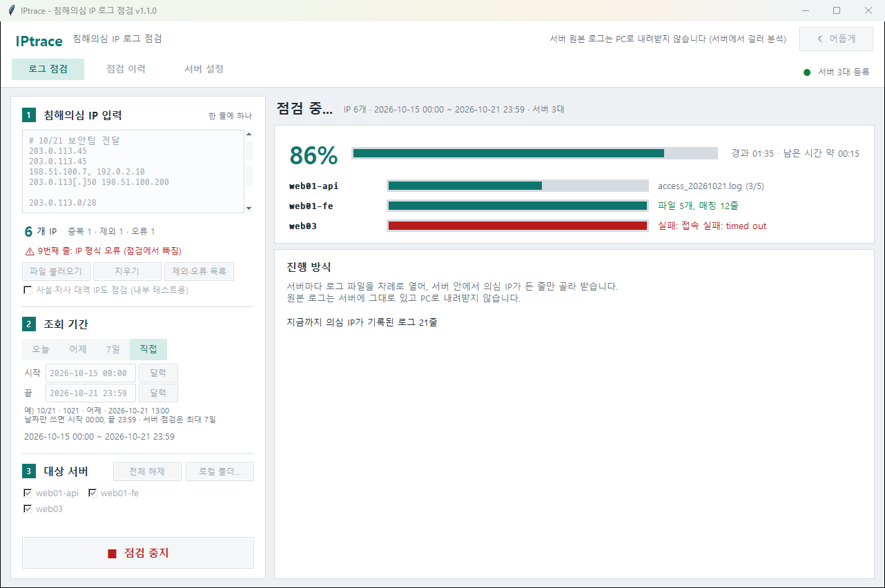
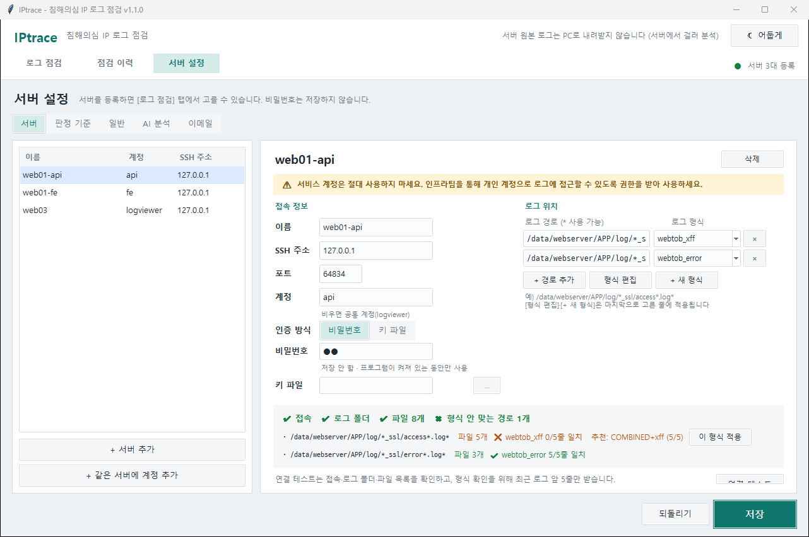
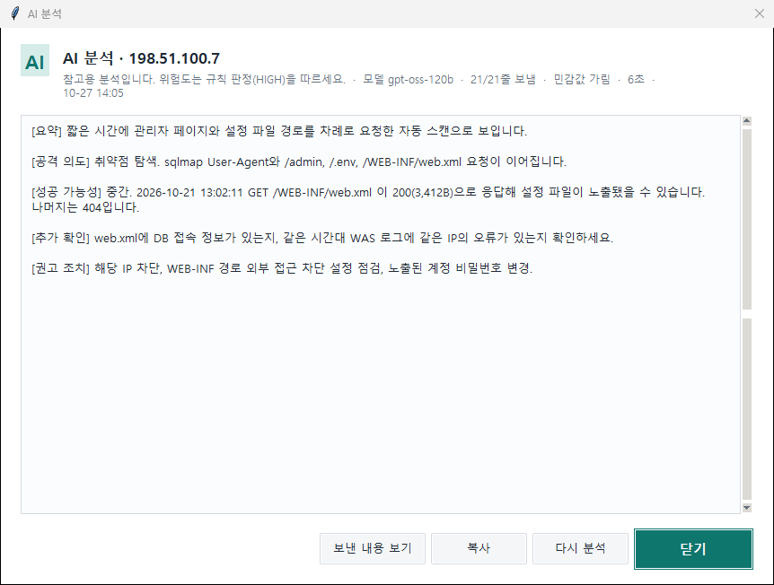

# IPtrace: 침해의심 IP 로그 점검 도구

보안팀이 전달한 침해의심 IP가 우리 서버 로그에 남아 있는지 확인하는 Windows 프로그램입니다.
여러 서버를 한 번에 점검하고, 찾은 로그로 위험도를 판정한 뒤 보고서와 회신 문구까지 만들어 줍니다.
**서버 원본 로그는 PC로 내려받지 않습니다.** 서버 안에서 의심 IP가 든 줄만 골라 받습니다.



## 왜 만들었나
침해의심 IP를 받으면 서버마다 SSH로 접속해 계정별 로그 폴더를 찾아가 `grep`으로 하나씩 검색하고, 찾은 로그를 보고 공격인지 직접 판단해 회신을 정리해야 했습니다.
원본 로그는 서버 밖으로 반출할 수 없고 내부망은 외부와 분리되어 있어, 이 과정을 안전하게 자동화하는 도구를 만들었습니다.

## 주요 기능
| 기능 | 내용 |
|---|---|
| 여러 서버 한 번에 점검 | 등록한 서버(계정별 로그 폴더 포함)를 SSH로 접속해 동시에 점검 |
| 서버에서 거르기 | 서버 안에서 `zcat \| grep -F`로 의심 IP가 든 줄만 받음. 로그 전체를 받는 명령은 만들 수 없음 |
| 위험도 판정 | 탐지 규칙(SQL 인젝션, XSS, 웹셸, 경로 조작, 스캐너 도구 등)과 응답 코드로 CRITICAL·HIGH·MEDIUM·LOW 판정 |
| 근거 제시 | IP별 요청 수·응답 코드 분포, 확인 근거, 원본 위치(파일:줄), 서버별 점검 상태 |
| AI 분석 (선택) | 사내 AI 게이트웨이로 공격 의도·성공 가능성·권고 조치를 받음 (참고용) |
| 보고서·회신 | HTML 보고서(또는 엑셀) 저장, 보안팀 회신 문구 복사 |
| 이메일 보내기 (선택) | 회신 요약을 본문으로, HTML 보고서를 첨부해 사내 메일 API로 보냄 |
| 점검 이력 | 지난 점검의 요약·근거 위치·검토 상태·메모 (로그 원문은 저장 안 함) |
| 다양한 로그 | WebtoB 접근·에러 로그 기본 제공, WAS·업무 로그는 형식을 직접 만들어 점검 |

## 동작 방식
```text
IP 입력 · 기간(최대 7일) · 서버 선택
        │
        ▼
[서버]  기간 안에 바뀐 로그 파일만 고름 → zcat | grep -F 로 의심 IP가 든 줄만 PC로 보냄
        (가장 낮은 우선순위 nice/ionice · 파일당 시간 제한 180초 · 파일당 최대 10만 줄 · 같은 장비는 차례로)
        │
        ▼
[PC]    로그 형식대로 읽기 → 기간 필터 → 탐지 규칙 → IP별 집계 → 위험도 판정
        │
        ├─ (선택) 사내 AI 분석: 민감값을 가린 로그를 보내 해석을 받음
        ▼
결과 화면 → 보고서 저장 · 회신 요약 복사 · 점검 이력
```

## 설치
1. 이 프로젝트의 **배포 → 릴리스**에서 `IPtrace-<버전>-win64.zip`을 받습니다.
2. 쓰기 가능한 폴더(예: `D:\iptrace\`)에 압축을 풉니다. `C:\Program Files`는 안 됩니다.
3. `iptrace.exe`를 실행합니다. Python 설치는 필요 없습니다.
4. 백신/EDR이 막으면 릴리스 설명의 SHA256으로 예외 등록을 요청하세요.

`iptrace.exe`만 따로 옮기면 실행되지 않습니다. 옆의 `_internal\` 폴더가 함께 있어야 합니다.
새 버전으로 바꿀 때는 `iptrace.exe`, `iptrace-cli.exe`, `_internal\`만 덮어쓰면 서버 설정과 점검 이력이 그대로 남습니다.

## 사용법
> **⚠ 서버 계정 주의**
> **서비스 계정은 절대 사용하지 마세요.** 인프라팀을 통해 **개인 계정으로 로그에 접근할 수 있도록** 권한을 받아 사용해 주세요.
> 필요한 권한은 로그 폴더 읽기뿐이며, 파일 쓰기·서비스 재시작·sudo 같은 권한은 필요 없습니다. root·관리자 계정도 쓰지 마세요.

1. **[서버 설정]**: [+ 서버 추가]로 이름, SSH 주소, 계정, 비밀번호, 로그 경로와 로그 형식을 넣고 [연결 테스트]를 누릅니다.
   - 처음 접속하는 서버는 호스트 키 지문을 서버 담당자와 확인한 뒤 신뢰합니다.
   - 로그 형식이 맞지 않으면 추천 형식이 나옵니다. [이 형식 적용]을 누르면 됩니다.
   - 같은 서버에 계정이 여러 개(api, fe)이고 계정마다 로그 폴더가 다르면 [+ 같은 서버에 계정 추가]를 씁니다.
2. **[로그 점검]**: 의심 IP를 한 줄에 하나씩 붙여 넣습니다. 중복, 사설·자사 대역, 형식 오류는 자동으로 걸러집니다.
3. 조회 기간([오늘] [어제] [7일] [직접], 최대 7일)과 대상 서버를 고르고 **[점검 시작]**을 누릅니다.
4. 결과에서 IP를 고르면 확인 근거, 로그, 원본 위치가 보입니다. 필요하면 **[AI 분석]**을 누릅니다.
5. **[회신 요약 복사]**로 회신 문구를, **[보고서 저장...]**으로 HTML 보고서를 만듭니다. 이메일 보내기를 켜면 [회신 요약 복사] 자리에 **[이메일 보내기]**가 나옵니다.
6. **[점검 이력]**에서 지난 점검을 찾아 검토 상태(확인 완료/조치 필요)와 메모를 남깁니다.

서버 담당자에게 따로 받은 로그 파일만 볼 때는 [로컬 폴더...]로 폴더를 고릅니다(하위 폴더 이름 = 서버 이름). 로컬 폴더는 기간 제한이 없습니다.

| 점검 중 | 서버 설정 | AI 분석 |
|---|---|---|
|  |  |  |

## 위험도 판정
탐지 규칙은 [`rules/signatures.json`](rules/signatures.json)에 있습니다 (규칙 82개, 버전 2026.10.26). 운영 중에 고칠 수 있습니다.

| 등급 | 예 |
|---|---|
| CRITICAL | 웹셸 업로드·동작 의심, 공격 요청이 200 응답 (성공 의심) |
| HIGH | 웹셸 의심 경로 200, 공격 요청 200 (성공 가능), 민감 파일 200 (정보 노출 의심) |
| MEDIUM | 공격 시도(403·404·500 등), 서버 오류 유발(5xx), 경로 스캔(404 반복), 스캐너 도구, 비정상 메서드 |
| LOW | 일반 접속 |

규칙 종류: URL 공격 패턴(SQL 인젝션, XSS, 경로 조작, 원격 명령 실행, Java 취약점, 웹셸, 민감 파일), 스캐너 User-Agent 21종, 비정상 메서드 10종, 웹셸 확장자 8종.

## 보안·안전 장치
- **로그 반출 없음**: 서버에서 실행할 수 있는 명령은 허용 목록(`find`, `zcat`, `grep`, `head` 등 읽기 전용)뿐이고, 로그 전체를 받는 명령은 만들 수 없습니다.
- **서버 부하 제한**: `nice`·`ionice`로 가장 낮은 우선순위, 파일당 시간 제한(기본 180초, 넘으면 서버가 스스로 멈춤), 파일당 최대 10만 줄, 조회 기간 최대 7일, 같은 장비의 계정은 차례로 점검.
- **서버 계정**: 서비스 계정은 쓰지 않고, 인프라팀을 통해 **로그 접근 권한을 받은 개인 계정**을 씁니다 (root·관리자 계정 사용 금지). 프로그램도 읽기 전용 명령만 보냅니다.
- **비밀번호**: 저장하지 않고 실행 중에만 기억합니다. 틀린 비밀번호는 다시 보내지 않아 계정 잠김을 막습니다.
- **AI 분석**: 보내기 전에 토큰·세션·주민번호 같은 민감값을 가립니다. 처음 보낼 때 확인을 받고, 위험도 판정은 규칙이 합니다(AI는 참고용).
- **이메일**: 연동 규격대로 제목·본문의 개인정보를 가리고 보냅니다. 첨부 보고서도 URL 쿼리의 민감값을 가립니다(설정).
- **기록**: 점검 이력에는 요약과 근거 위치만, 감사 로그에는 점검·저장·AI 사용·이메일 발송 기록(건수·주문번호·거래번호)만 남깁니다. 로그 원문과 메일 주소·내용은 남기지 않습니다.

## AI 분석 (선택)
[서버 설정] > AI 분석에서 사내 AI 게이트웨이의 주소, 모델, 키를 넣으면 켜집니다.
- 방식: OpenAI 호환(`/v1/chat/completions`) 또는 Anthropic(`/v1/messages`, 모델 이름 필수)
- 보내는 내용: 고른 IP의 로그(같은 요청은 묶어서 기본 60줄까지)와 규칙 판정
- 받는 내용: 요약, 공격 의도, 성공 가능성, 추가 확인할 것, 권고 조치
- 키는 기본적으로 메모리에만 두고, [키 저장]을 켜면 Windows 계정으로 암호화해 저장합니다.
- 보고서를 저장할 때 아직 분석하지 않은 IP를 함께 분석할 수 있습니다.

### AI 설정 방법
[서버 설정] > **AI 분석** 탭에 아래처럼 넣고 **[연결 테스트]**로 확인한 뒤 [저장]합니다.

<!-- TODO(임시 표): <...> 칸은 사내 AI 게이트웨이 담당 부서에 확인한 실제 값으로 채운다 -->
| 항목 | OpenAI 호환 | Anthropic | 설명 |
|---|---|---|---|
| AI 분석 사용 | 체크 | 체크 | 켜야 결과 화면에 [AI 분석] 버튼이 생김 |
| API 방식 | OpenAI 호환 | Anthropic | 게이트웨이가 제공하는 방식 (Claude는 Anthropic) |
| 주소 (URL) | `https://<게이트웨이 주소>/v1` | `https://<게이트웨이 주소>/v1` | `/v1`로 끝나면 OpenAI는 `/chat/completions`, Anthropic은 `/messages`를 자동으로 붙임 |
| 모델 이름 | `<모델 이름>` (비워도 됨) | `<모델 이름>` (**필수**) | 게이트웨이에서 쓸 수 있는 모델 |
| 키 헤더 이름 | `Authorization` | `x-api-key` | 방식을 고르면 자동으로 채워짐. 게이트웨이가 다르게 요구하면 바꿈 |
| 키 앞 글자 | `Bearer ` (뒤 빈칸 포함) | (비움) | |
| API 키 | `<발급받은 키>` | `<발급받은 키>` | 기본은 프로그램을 끄면 지워짐 |
| 이 PC에 키 저장 | 선택 | 선택 | 체크하면 Windows 계정으로 암호화해 저장 (다른 PC·계정에서는 못 씀) |
| 추가 헤더 | 필요할 때만 | 필요할 때만 | 게이트웨이가 키 외에 더 요구하는 헤더. 한 줄에 `이름: 값` |
| 보낼 최대 줄 수 | `60` | `60` | IP 하나당. 같은 요청은 한 줄로 묶음 |
| 시간 제한 | `120` | `120` | 초. 시간 초과가 자주 나면 `300` 정도로 늘림 |
| 민감값 가리고 보내기 | 켬 | 켬 | 토큰·세션·비밀번호 값, 주민번호, 전화번호, 카드번호, 이메일을 `***`로 |
| TLS 인증서 확인 | 켬 | 켬 | 사내 인증서 오류가 나면 끔 |
| 시스템 프록시 사용 | 끔 | 끔 | 사내 주소는 보통 바로 접속 |
| 거절되면 대체 모델 사용 | - | 끔 | Claude API에 바로 연결할 때만. 게이트웨이는 지원하지 않을 수 있음 |

주소·모델·키는 사내 AI 게이트웨이 담당 부서에서 받습니다. [연결 테스트]는 저장하지 않아도 지금 입력한 값으로 시험합니다.

## 이메일로 보내기 (선택)
[서버 설정] > **이메일**에서 켜면 결과 화면의 [회신 요약 복사]가 **[이메일 보내기]**로 바뀝니다.
누르면 받는 사람·참조·제목·**전할 말**을 확인하고 고칠 수 있는 창이 뜨고(보낼 본문 미리보기 포함), [보내기]로 보냅니다. 본문을 글자로 복사하려면 창의 [본문 복사]를 씁니다.

**메일 본문** (HTML): 전할 말 → 요약 카드(점검한 IP·로그 발견·위험·미발견) → 조회 기간·점검 서버(수집 실패 강조)·점검 일시·분석 범위 → **로그가 발견된 IP 표**(위험도 높은 순, 위험도·IP·요청 수·응답·판정) → 첨부 안내. 제목은 `[IPtrace] 침해의심 IP 점검 결과 [위험 IP 발견] 위험 1 · 발견 4 / 점검 6개 (11-23 14:51)` 모양입니다.

- 연동: 사내 메일 API **POST `/email/send`**, 요청·응답은 JSON
- 공통 요청 헤더: `Content-Type`(application/json), `Authorization`(발급받은 토큰), `appServiceSeq`(서비스코드), `apiVersion`(`1.0` 고정, 자동)
- 보내는 것: `msgFrom`(발신자), `msgTo`·`msgCc`(여러 명은 `,`), `title`·`contents`(개인정보 가림), `contentType`=`text/html`,
  `ordDay`·`ordTime`·`ordNo`(보낼 때마다 `IPTRACE…`로 새로 만듦), `fileList`(HTML 보고서, Base64, `fileEncoding`=`UTF-8`)
- 첨부 한도: 파일 하나 10MB, 전체 20MB. 보고서가 10MB를 넘으면 첨부 없이 보내고 [보고서 저장]으로 따로 전달합니다.
- 성공 판단: 응답 `resCode`가 [성공 응답 코드](기본 `0`, 숫자는 값으로 비교해 `0`·`0000` 모두 성공)이고 `resData.transStatus`가 `O`(요청 성공). `E`(시스템 오류)·`D`(사업자측 오류)·`X`(요청 실패)는 실패로 알립니다.
- AI 분석을 켰고 아직 분석하지 않은 IP가 있으면, [보고서 저장]처럼 **보내기 전에 분석할지 묻습니다**. [예] 분석한 뒤 보내기 / [아니요] AI 분석 없이 보내기 / [취소]. 분석한 IP는 첨부 보고서에 AI 분석이 함께 들어갑니다.
- 첨부 파일 이름: 제목 앞말을 붙여 `[IPtrace]점검결과_날짜_시각.html` (앞말이 없으면 `IPtrace_점검결과_날짜_시각.html`). 보내기 창에서 바꿀 수 있습니다(확장자는 `.html`로 맞춤).

### 이메일 설정 방법
<!-- TODO(임시 표): <...> 칸과 토큰 헤더·성공 코드는 메일 발송 API 담당 부서에 확인한 실제 값으로 채운다. 발송 주소·받는 사람은 기본값이 들어 있음 -->
| 항목 | 넣을 값 (예) | 설명 |
|---|---|---|
| 이메일 보내기 사용 | 체크 | 켜야 결과 화면에 [이메일 보내기]가 생김 |
| 발송 주소 (URL) | `https://internal.mailapi.com` (기본값) | `/email/send`로 끝나지 않으면 자동으로 붙임 |
| 서비스코드 | `<서비스코드>` | **필수**. 헤더 `appServiceSeq` (관리자에게 발급받은 기준정보) |
| 토큰 헤더 이름 | `Authorization` | 규격의 인증 토큰 헤더 |
| 토큰 앞 글자 | (비움) | 규격은 토큰만 보냄. `Bearer `가 필요할 때만 넣음 |
| 인증 토큰 | `<발급받은 토큰>` | 기본은 프로그램을 끄면 지워짐 |
| 이 PC에 토큰 저장 | 선택 | 체크하면 Windows 계정으로 암호화해 저장 |
| 추가 헤더 | 필요할 때만 | 한 줄에 `이름: 값` |
| 발신자 | `<보내는 주소>;<보내는 이름>` | **필수**. 예: `secu@회사.co.kr;보안팀`. 이메일을 켰는데 발신자·받는 사람이 비었거나 주소 형식이 틀리면 [저장]되지 않음 |
| 기본 받는 사람 | `security@foo.bar` (기본값) | **필수**. 보낼 때 창에서 바꿀 수 있음 |
| 기본 참조 | `<주소>, <주소>` | 필요할 때만 |
| 제목 앞말 | `[IPtrace]` | 제목과 첨부 파일 이름 맨 앞에 붙는 말 |
| 성공 응답 코드 | `0` | 응답 `resCode`가 이 값이면 성공 (숫자는 값으로 비교: `0` = `0000`). 비우면 처리 상태(`transStatus` = `O`)만 봄 |
| 시간 제한 | `30` | 초 |
| 첨부 보고서의 URL 민감값 가리기 | 켬 | 토큰·세션 같은 쿼리 값을 `***`로 |
| TLS 인증서 확인 / 시스템 프록시 | 켬 / 끔 | AI 설정과 같음 |

[시험 메일 보내기]를 누르면 **발신자와 받는 사람을 물어본 뒤**(설정 값이 기본으로 채워짐), 저장하지 않아도 지금 입력한 값으로 시험 메일을 보냅니다.

## 로그 형식
[서버 설정] > 서버 > **로그 위치** 표에서 경로마다 형식을 고릅니다. 한 서버에서 접근 로그, 에러 로그, WAS 로그를 함께 볼 수 있습니다.

| 로그 예 | 형식 |
|---|---|
| `1.2.3.4 - - [21/Oct/2026:13:00:00 +0900] "GET /a.jsp HTTP/1.1" 200 512` (WebtoB·Tomcat·JEUS 접근 로그) | `%h %l %u %t "%r" %s %b` |
| `[2026-10-23T02:22:37] [CLIENT(1.2.3.4)] [E] ... GET /containers/json HTTP/1.1` (WebtoB 에러 로그, 기본 제공 `webtob_error`) | `[%{%Y-%m-%dT%H:%M:%S}t] [CLIENT(%h)] %*` |
| `2026-10-21 13:00:00,123 INFO [exec-1] 1.2.3.4 GET /a.jsp 200` (WAS 로그) | `%{%Y-%m-%d %H:%M:%S,%f}t %* %h %m %U %s%*` |
| `[2026-10-21 13:00:00] [INFO] login ok user=kim ip=1.2.3.4` (업무 로그) | `[%{%Y-%m-%d %H:%M:%S}t] %* ip=%h%*` |

- `%h`(IP)는 꼭 있어야 합니다. `%{...}t`는 시간 모양, `%*`는 아무 글자입니다. [+ 새 형식]·[형식 편집]에서 [예시 넣기]와 샘플 줄 [시험]으로 만들 수 있습니다.
- IP와 시간만 읽혀도 발견 횟수·기간 필터·원본 위치가 나옵니다. 요청·응답 코드가 없으면 공격 패턴 판정만 빠집니다.
- WAS가 WebtoB 뒤에 있으면 로그에 WebtoB 서버 IP가 찍힐 수 있습니다. 이때는 `X-Forwarded-For` 값이 로그에 남아야 의심 IP로 찾을 수 있습니다.
- 결과에 **'해석 실패 N줄'**이 나오면 [읽지 못한 줄 보기]로 형식이 맞지 않은 줄을 확인하세요. 의심 IP가 든 줄은 놓친 기록일 수 있습니다.

## 명령줄 (CLI)
```bash
iptrace-cli check -i ioc.list --yesterday --reply
```
```bash
iptrace-cli check --ip 203.0.113.45,198.51.100.7 --days 7 -o out\result.html
```
```bash
iptrace-cli servers test --trust
```
```bash
iptrace-cli doctor
```
종료 코드: `0` 접속 IP 없음 / `1` 접속 IP 있음 / `2` 실행 오류 / `3` 일부 서버 수집 실패. 보고서 형식은 `-o` 확장자로 정합니다(`.html` 기본, `.xlsx`).

## 프로젝트 구조
```text
iptrace/
  core/            분석 엔진 (화면과 무관)
    collector.py   SSH 수집: 서버에서 거르기, 원격 명령 허용 목록
    parser.py      로그 형식 → 파서, 형식 자동 확인
    matcher.py     IP·대역 매칭
    detector.py    탐지 규칙·위험도 판정
    aggregator.py  IP별 집계
    engine.py      점검 실행 (화면·CLI 공통)
    ai.py          사내 AI 분석 (민감값 가림)
    mailer.py      이메일 보내기 (사내 메일 API 연동)
    report.py, report_html.py   보고서(HTML·엑셀), 회신 요약
    history.py, audit.py        점검 이력(SQLite), 감사 로그
    config.py, ioc.py, models.py, integrity.py
  gui/             tkinter 화면 (로그 점검·점검 이력·서버 설정 탭)
  cli.py           명령줄 도구
rules/signatures.json        탐지 규칙
config/config.example.json   설정 예시
tests/                       테스트 (가짜 SSH 서버·가짜 AI 게이트웨이 포함)
tools/                       빌드·릴리스·화면 캡처 스크립트
build/                       PyInstaller 빌드 설정
screens/                     화면 캡처 (가짜 데이터)
build_exe.bat · doctor.bat · make_release.bat
```

## 개발·빌드
필요한 것: Windows 64비트, Python 3.10~3.13

| 할 일 | 방법 |
|---|---|
| 소스로 실행 | `.venv\Scripts\python -m iptrace` (인자를 주면 CLI) |
| 테스트 | `.venv\Scripts\python -m pytest` (120개) |
| exe 빌드 | **`build_exe.bat`** 더블클릭 |
| 실행 환경 점검 | **`doctor.bat`** 더블클릭 |
| 릴리스 파일 만들기 | **`make_release.bat`** 더블클릭 → `release\`에 zip과 릴리스 설명 |
| 화면 캡처 다시 만들기 | `.venv\Scripts\python tools\capture_screens.py` |

**`build_exe.bat`이 하는 일**: 아래 두 명령을 차례로 실행합니다. 명령 프롬프트에서 직접 치는 것과 같은 `python`을 쓰므로, 그 `python`에 PyInstaller·paramiko·openpyxl이 설치되어 있어야 합니다.
```bash
python -m iptrace doctor
```
```bash
python -m PyInstaller build\iptrace.spec --clean --noconfirm
```
- doctor는 손으로 옮기다 빠지거나 중간까지만 붙여넣은 파일을 찾습니다. 문제가 나오면 멈추고, 아무 키나 누르면 그래도 빌드합니다.
- 결과는 `dist\iptrace\`입니다. 빌드할 때마다 이 폴더를 통째로 새로 만들어 그 안의 `config\`·`data\`가 지워지니, exe는 다른 폴더(예: `D:\iptrace\`)에 복사해 쓰고 새 버전은 `iptrace.exe`·`iptrace-cli.exe`·`_internal\`만 덮어씁니다.

**릴리스 순서**: `iptrace/__init__.py`의 `__version__`과 [`CHANGELOG.md`](CHANGELOG.md)를 고침 → `build_exe.bat` → `make_release.bat` → GitLab **배포 → 릴리스 → 새 릴리스**에서 태그(예: `v1.1.0`)를 만들고, 릴리스 설명을 붙여 넣은 뒤 zip을 첨부.

소스를 고친 뒤에는 `python tools/make_manifest.py`로 `iptrace/manifest.py`(doctor가 쓰는 파일 목록)를 다시 만듭니다.

**문서 보안(DRM) 주의**: `.txt` 파일을 자동으로 암호화하는 PC에서는 설치된 패키지 정보(`*.dist-info\*.txt`)가 암호화돼 pip·pytest·PyInstaller가 깨질 수 있습니다. 그때는 패키지를 다시 설치하거나 Python 폴더를 DRM 예외로 요청합니다. exe에는 이 `.txt`를 넣지 않습니다. 그래서 설치·빌드에 쓰는 파일은 `.txt`를 쓰지 않습니다(`requirements*.in` 등).

## 문서
- [CHANGELOG.md](CHANGELOG.md): 버전별 변경 내역
- [PLAN.md](PLAN.md): 기능 명세
- [PLAN_v1.1_추가기능.md](PLAN_v1.1_추가기능.md): 추가 기능 계획
